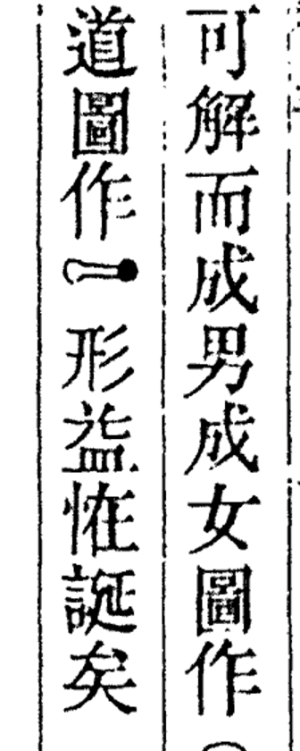

# 文本中插入图片：图片格与插图块（总设计，已评审 10-23）

> 2026-10-23 PDT，A31 起草，Jira **GUJI-737**（父卡 GUJI-637 M10 精校）。**2026-10-23 Sheldon 评审通过，§八 五件按推荐定，见 §十二。**
> 涉及格式规范 guji-format（spec 01 cord、02 char、03 markdown、新增 09 fig），落地时以 guji-format 为准，本文是来龙去脉。

---

## 0. 一页话

1. 古籍里有两类「不是字、但要显示」的东西，分开处理：
   - **图片格**：在正文字流里占一格（偶尔连几格）的图形，Unicode 没有对应字。例：册 005 第 148 叶 2 列 14 格「圖作▢形」（见下图）。
   - **插图块**：占若干列、半页或整页的插图、图表、卦图、地图。正文到这里断开，插一张图，再接正文。
2. **char 里只加一个引用键**，图的信息另放一个新文件 `NNN.fig.json`：
   - 图片格：格上加 `fig: "<图 id>"`，`c` 照旧写 `□`（不带 `lacuna`）。不认识 `fig` 的旧工具只会把它显示成方框，不出错。
   - 插图块：列表里加一项 `kind: "figure"` 的「图列」，按读序插在列之间，`fig` 指向图 id，不含格。
   - cord：图片格的框照旧在 `cells[]`；插图块的框进 `marks[]`，新 kind `figure`。
   - norm：不改格式。图片格不许出现在 norm 里（校验拦）。
3. **图片文件放 book-text 仓**，和文本一起走 PR、一起发布：`<版本目录>/fig/NNN/<图 id>.<webp|png|svg>`。
   - 第一版一律是**从书影裁出的像素图**（cv 导出时自动裁，原图取 R2 页图全分辨率）。
   - 以后可以换成**人工重绘的矢量图**（SVG），只换文件、改 fig.json，不升文本版本。
4. **怎么定一格是图**：走人裁事件，不在 book-text 手改（遵守 runbook「不在 book-text 里直接改字」）。
   - 精校页卡片加一个选项「是图形，不是字」；cv 加人裁种类 `figure`；导出器据此写 char／cord／fig。
   - 插图块先由控制台手工画框（页级覆盖事件），自动检测以后再说。
5. **显示**：
   - 阅读器：图片格按一个字大小显示图（随字号缩放，夜间模式反色）；插图块在两列之间显示整图，点开看书影原位。悬停都有说明文字。
   - 复制得到 `〔图：说明〕`；全文检索跳过图片格；繁简转换不碰。
   - 精校页：卡片显示裁图，已定为图的格不再进待审。
6. §八 的 5 件事 Sheldon 已于 10-23 定（全部按推荐）。



（左列第 4 字就是 148:2:14：左边半个圈，右边一个实心点，中间一横连着。Unicode 没有这个形状。右列末字 148:1:21 是 ○，有码位，按 cv 的「特殊符号进候选」方案处理，不归本设计。）

---

## 一、目标

- 刻本上没有对应 Unicode 字的图形、插图、图表，在文本和网站上**显示成图片**，不再用 □ 冒充阙文。
- 图片的来源可追：哪一页、哪个框、谁裁的或谁画的、文件哈希。
- 旧数据、旧工具不受影响：没用到图的章一个字节不变；不认识新键的工具不出错。

**为什么现在做**：GUJI-737（册 005 1.0 演练 GUJI-731 的尾巴）要求「截图入库、文本和阅读端以图片显示、撤销阙字标记、重核 G3b（书影一致）和 G3c（读者端可达）」。只补这一格的话，下一本带插图的书（卦图、地图、算书）还得再设计一次，所以按通用方案做，148:2:14 是第一个用例。

## 二、不做什么

1. **有 Unicode 码位的符号**（○◎●□△╳⊙ 等）不走这里，照 open-guji-cv `doc/design/特殊符号进字符候选集-设计.md` 进候选、定成字。
2. **Unicode 没收、但能写 IDS 的汉字**不走这里，照旧 `c` 写近似字＋`zi` 记 IDS，显示交 kaiyuanguji-web GUJI-721（KAGE 出 SVG）。图片格只给「根本不是字」的图形。
3. **印章**第一版不显示：印章是后来藏家钤的，不属于书的正文，仍是 cord `marks` 的 `seal`，阅读器不画。以后要做「印章一览」另开卡。
4. **不做自动检测插图**：第一版插图块靠人画框。页面类型模型（A21）以后能判出插图页时再接。
5. **不做排版输出**（luatex-cn／webtex-cn／PDF）：先只管 book-text 数据和网站。
6. **不改 punct、entity、decision 的格式**：它们锚格位、校验 `c`，图片格的 `c` 是 `□`，照常工作。

## 三、现状（实测）

| 项 | 数 | 来源 |
|---|---|---|
| 四庫總目殿本 20 册 char 的格数 | 549,085 | 下面脚本，book-text main `931a3bb3`（10-23） |
| 其中阙文 `lacuna` | 3,438 | 同上 |
| 册 005 阙文 | 2 格：41:9:7、148:2:14 | 同上 |
| 册 005 已定成符号的格 | 4 格：148:1:20 ⊙、148:1:21 ○、179:9:11 ○、179:9:14 ╳ | 同上 |
| cord `marks` | blank 101,833、excluded 581、**seal 0** | 同上（印章区现在导出成 excluded，见 cv runbook S17） |
| 148:2:14 的框 | `[1648, 1873, 116, 44]`，页图 2353×3121，sha256 `0b9b16fa…` | `005.cord.json` |
| guji-format 里图片相关的定义 | 无。char 格对象 `additionalProperties: false`，cord `marks.kind` 只许 blank／seal／excluded | spec 01、02，schemas/ |
| guji-markdown 图片语法 | 只有 CommonMark 的 ``，没有古籍指令 | spec/syntax.md §0、directives.md |
| 阅读器对 char 的处理 | book-index-ui `adaptCharCord` 把 `lane/lacuna/guess/guess_c/zi` 带到字上，`GujiTextViewer` 按类名显示 | book-index-manager `ui/src/core/guji-char-cord.ts`、`components/Reader/GujiTextViewer.tsx` |
| 全文索引 | `indexer/lib/char-text.mjs` 跳过 `lacuna` 格 | kaiyuanguji-web |

统计脚本（在 book-text 的 `Book/g/z/k/96mid1ogzk/default/` 下跑）：

```python
import json, glob, collections
tot = collections.Counter()
for f in sorted(glob.glob('*.char.json')):
    for p in json.load(open(f))['pages']:
        for col in p['columns']:
            for x in col['cells']:
                tot['cells'] += 1
                tot['lacuna'] += bool(x.get('lacuna'))
    for p in json.load(open(f.replace('char', 'cord')))['pages']:
        for m in p.get('marks', []):
            tot['mark_' + m['kind']] += 1
print(dict(tot))
```

## 四、数据格式

### 4.1 char（guji-char v0.3）

**图片格**：格对象加一个键 `fig`。

```jsonc
{"a": "148:2:14", "c": "□", "fig": "f148-2-14"}
```

- `fig`：图 id，在同章 `fig.json` 里必须有。
- `c`：写 `□`，**不带** `lacuna`（这格不是看不清，而是图）。理由见下表。
- `fig` 与 `lacuna`、`guess`、`guess_c`、`zi` 互斥。
- 连占几格的图（少见）：每格都写同一个 `fig`，阅读器把连续同 id 的格合成一张图。

`c` 写什么，比过三种：

| | `□`＋`fig`（推荐） | U+FFFC（对象替换符）＋`fig` | 私用区码位 |
|---|---|---|---|
| 旧工具（不认 `fig`） | 显示方框，和刻本上的 □ 一样；不出错 | 多数字体显示空白或怪框，用户看不懂 | 显示豆腐块 |
| punct `pre_char`、entity `text` 校验字 | `□`，现有工具照常 | 要各处认这个新字符 | 同左 |
| 和现有约定 | 与「未收字写近似字＋`zi`」同一路数；与 `guess_c` 「旧读取方静默降级」同一取法 | 新约定 | 规范一向避开私用区 |
| 坏处 | 只看 `c` 分不出「刻的方框」和「图」，必须看 `fig` | — | — |

**插图块**：`columns[]` 里加一项「图列」。

```jsonc
{"col": 3, "kind": "figure", "span": 4, "fig": "p52-fig1", "cells": []}
```

- `kind: "figure"`：新列类别；`cells` 必须为空。
- `col`：图块右边第一列的列号；`span`：占几列（整页图写满本页列数）。被占的列号不再另出列项。
- 读序就是 `columns[]` 的顺序，图插在前后两列之间。
- 整页都是图（插图页）：本页 `columns` 只有这一项。
- 图块里带的图注、题字（如「河圖」二字）：**照常作为字列录入**（图列之前或之后），不塞进图里——这样能检索、能标点。

### 4.2 cord（guji-cord v0.2）

- 图片格：框照旧在 `cells[]`，不变。
- 插图块：`marks[]` 加 `kind: "figure"`：

```jsonc
{"kind": "figure", "id": "mxxxxxxx", "fig": "p52-fig1", "col": 3, "span": 4, "box": [x, y, w, h]}
```

- `fig` 只许出现在 `kind: figure` 上，且在同章 `fig.json` 里有。

### 4.3 fig（新文件 `NNN.fig.json`，guji-fig v0.1，spec 09）

每章一份，**只有用到图的章才有**；章条目用 `fig_file` 声明（和 `norm_file` 同一套）。

```jsonc
{
  "$schema": "https://open-guji.org/schema/fig/v0.1.json",
  "book_id": "96mid1ogzk",
  "volume": 5,
  "figures": [
    {
      "id": "f148-2-14",
      "kind": "inline",                 // inline 图片格 ／ block 插图块
      "page": 148,
      "box": [1648, 1873, 116, 44],     // 原图像素框，与 cord 一致（校验）
      "alt": "左半圈连一实点",          // 说明文字：悬停、读屏、复制都用它；必填
      "file": "fig/005/f148-2-14.png",  // 相对版本目录
      "sha256": "…",
      "mime": "image/png",              // image/png ／ image/webp ／ image/svg+xml
      "width": 116, "height": 44,       // 像素图的像素；SVG 写 viewBox 宽高
      "source": "crop",                 // crop 书影裁图 ／ redraw 人工重绘
      "by": "cv:export"                 // 谁做的：cv:export ／ human:<名字>
    }
  ]
}
```

- `id`：`[a-z0-9-]`，章内唯一，建议 `f<页>-<列>-<格>`（图片格）、`p<页>-fig<n>`（插图块）。**id 不跟格位变**：重切后格号变了，id 照旧，只改 char 里引用它的格。
- `alt` 必填：没有 Unicode 字，读屏和复制只能靠它。
- 不跟踪版本（和 cord、norm 一样）：换图（裁图换成重绘）不升文本线。
- 哪些格是图、图在哪个位置，记在 char 里，**改它照 char 走：升文本线**。

### 4.4 图片文件

- 路径：`<版本目录>/fig/<NNN>/<图 id>.<扩展名>`，真源，存 main。
- 裁图：从 **R2 页图全分辨率**（cord `image.sha256`）按 `box` 外扩 2 像素裁，存 PNG（图片格，几百字节）或 WebP（插图块，有损 q90）。**不做去底、二值化**，保持书影原貌；读者端按主题调色（§6.1）。
- 重绘：SVG，只许 `path`／`circle`／`rect` 等图形元素，不许脚本、外链、内嵌位图（校验拦），`fill="currentColor"` 便于跟正文同色。
- 大小上限：单个文件 ≤ 1 MB，超过的插图块先降到长边 2000 像素。
- 授权：书影是公有领域，裁图随条目 original 版本走 CC0；重绘图同样 CC0（入库时说明）。

### 4.5 guji-markdown（lines.md、rich.md）

新指令 `tu`（图），两种形态：

| 场合 | 写法 | 例 |
|---|---|---|
| 图片格（行内） | `:tu[说明]{id=…}` | `圖作:tu[左半圈连一实点]{id=f148-2-14}形益恠誕矣` |
| 插图块（块级，首次启用 leaf 形态） | `::tu[说明]{id=…}` 单独一行 | `::tu[河圖]{id=p52-fig1}` |

- 渲染器拿 `id` 到同章 fig.json 找文件；找不到就显示 `〔图：说明〕`。
- `char → lines.md` 仍要逐字节可还原：转换器遇到 `fig` 格写 `:tu[…]{id=…}`，反向转换读回 `fig`。

### 4.6 和其他层的关系

| 层 | 规则 |
|---|---|
| punct | 可以锚在图片格上（图后面可以有句读），`pre_char` 是 `□` |
| entity | 专名跨过图片格时 `text` 里是 `□`；建议不跨（校验只提示） |
| norm | **不许**有图片格的条目（图没有通行字） |
| decision | 可以有：「这格是图还是某个字」拿不准时，候选里写 `{"kind": "figure"}`（08 v0.3 另议，第一版不做） |
| 全文检索 | 图片格、图列都跳过（和阙文一样） |

## 五、生成流程

```
精校页／控制台：人定「这格是图」或画插图框
        │  网站票 choice=figure（图片格）／控制台 override figure_region（插图块）
        ▼
cv：guji cellvotes → 人裁事件  verdict=figure（新种类）、figure_region（新覆盖事件）
        │  guji db sync（推库，等 Sheldon 说「推库」）
        ▼
cv 导出（Step9，guji_char_cord.py）
        │  图片格：char 写 c=□＋fig；cord 不变
        │  插图块：char 写图列；cord 写 marks.figure
        │  裁图：取 R2 页图，按框裁，写 fig/NNN/*.png|webp，生成 NNN.fig.json（alt 取人裁时填的说明）
        ▼
book-text PR（导出结果＋图片文件），升文本线 minor／patch
        │  本仓校验 F-OV-13（见 §7）
        ▼
网站发布（同步 book-text → COS，图片随章文件一起传） → 阅读器、精校页显示
```

要点：

1. **人定是图的时候要写 `alt`**：网站卡片选「是图形」时弹一个说明框（可空，空时导出写「图形符号」），控制台画框时同样。
2. **重切不丢**：`figure` 人裁和别的人裁一样锚页号＋框，重切后按框重叠重绑（cv 设计 15）。
3. **换成重绘图**：人做好 SVG，直接开 book-text PR 改 fig.json 的 `file`／`source`／`sha256`；这一步不改字，不经 cv（和 norm 人工改同一性质）。cv 下次导出时**保留**已有的 `source: redraw` 条目，不用裁图覆盖（导出器规则）。
4. **GUJI-737 这一格**：等 cv、网站的改动落地后走正规链路。若 1.0 演练等不及，可以先手工补一版（见 §8 第 5 条）。

## 六、显示

### 6.1 阅读器（book-index-ui，kaiyuanguji-web 用它）

- `adaptCharCord` 把 `fig` 带到字上，另读 `fig.json`（`loadDuiduFiles` 多取一个声明了的文件）。
- **图片格**：
  - 渲染成一个字宽的 `<span class="guji-text-char is-fig">`，里面 ``，按字框比例缩放到 1em 以内、居中；
  - 原字 `□` 保留在 DOM 里但透明（和 GUJI-721 缺字框同一手法），复制时用 `〔图：说明〕` 替换；
  - `title`／`aria-label` 写「图形符号：说明」；
  - 夜间模式：像素图加 `filter: invert(1)`（刻本黑字白底反过来正好），SVG 用 `currentColor`；
  - 繁简转换跳过。
- **插图块**：在图列的位置插一个块，宽度占满正文栏，最大高度一屏；下面一行小字写说明；点一下在书影栏定位到原页原框。
- **对读版面**（书影栏）：图片格和普通格一样画框；插图块画一个虚线框。
- **取不到图**（文件 404 或 fig.json 没有）：显示 `〔图：说明〕` 的小标签，不显示裸 □。

### 6.2 精校页（kaiyuanguji-web）

- 卡片加选项「是图形，不是字」（和「切坏」「看不出」并列），选了弹说明框。
- 已定为图的格不再进待审单；需要复看时在团队单里显示裁图。
- 待审单（guji-proof）不改格式：`img` 本来就是裁图。

### 6.3 全文检索与别的消费方

- indexer `char-text.mjs`：跳过 `fig` 格和 `kind: figure` 列。
- 搜索结果摘要里出现图片格的位置显示 `〔图〕`。

## 七、校验（book-text）

新增 **F-OV-13**（`scripts/validate_text_format.py`，带单测）：

1. 章条目声明了 `fig_file`，文件就必须存在；char 里有 `fig` 或图列，就必须声明 `fig_file`。
2. char 每个 `fig`、cord 每个 `marks.figure.fig` 在 fig.json 里有；fig.json 每个图都被引用（不留孤图）。
3. 图片格 `c == "□"`，且不带 `lacuna`／`guess`／`guess_c`／`zi`；图列 `cells` 为空。
4. fig.json 的 `file` 存在，`sha256` 对得上，大小 ≤ 1 MB；SVG 不含 `script`、`foreignObject`、外链、`image`。
5. fig.json 的 `page`、`box` 与 cord 一致（图片格对 `cells[]`，插图块对 `marks[]`）。
6. norm 里没有图片格。

guji-format 同时出 char v0.3、cord v0.2、fig v0.1 三份 schema，book-text bump `.github/guji-format.pin`。

## 八、要 Sheldon 定的事（10-23 已定：全部按「推荐」列）

| # | 问题 | 推荐 | 另一选择 |
|---|---|---|---|
| 1 | 图片文件放哪 | **book-text 仓里**（`fig/NNN/`），随文本走 PR、随章文件发布到 COS；文本仓自足，国内能访问 | R2 内容寻址（`blob.open-guji.com/sha256/…`），book-text 只存哈希：仓不长，但网站要多一条发布链，R2 在国内访问不稳 |
| 2 | 图片格 `c` 写什么 | **`□`**（不带 lacuna），旧工具降级为方框 | U+FFFC（对象替换符）：语义更准，但各处要认新字符，旧工具显示怪框 |
| 3 | 复制图片格得到什么 | **`〔图：说明〕`** | 只得 `□`；或什么都不出 |
| 4 | 印章要不要显示 | **第一版不显示**（不是正文） | 作为插图块显示在页边 |
| 5 | GUJI-737 这一格等不等正规链路 | **等**：B1–B5 合计约 10 小时工作量，演练顺便验证新链路 | 先手工在 book-text 补一版（违反「不在 book-text 直接改字」，要 Sheldon 明说同意），之后由导出覆盖 |

## 九、分块、负责方与时间

| 块 | 内容 | 仓 | 负责 Project | 估时 | 依赖 |
|---|---|---|---|---|---|
| B1 格式 | spec 02 char v0.3、01 cord v0.2、新 09 fig v0.1、03／directives 加 `tu`；三份 schema；夹具 | guji-format | A31（起草），A33、A34、A41 知会 | 约 1.5 h | 本设计评审通过 |
| B2 校验 | F-OV-13＋单测；`index.json` 认 `fig_file`；pin bump；`ORIGINAL.md` 补 fig 一行 | book-text | A31 | 约 1 h | B1 |
| B3 人裁与导出 | 人裁种类 `figure`、覆盖事件 `figure_region`；`cellvotes` 认 `choice=figure`；导出器写 char／cord／fig 与裁图；保留 redraw | open-guji-cv | **A2**（A20 定事件与导出；经协调者发） | 约 3 h | B1 |
| B4 阅读器 | `adaptCharCord` 带 `fig`；GujiTextViewer 图片格与插图块；复制替换；夜间模式；单测 | book-index-manager（book-index-ui） | **A41** | 约 2.5 h | B1 |
| B5 网站 | `loadDuiduFiles` 取 `fig_file`；COS 同步带上 `fig/`；精校卡「是图形」选项与说明框；indexer 跳过 | kaiyuanguji-web | **A41**（精校页）、**A42**（indexer） | 约 2 h | B1、B4；上线经 Deploy |
| B6 首例落地 | 148:2:14：投票或控制台定图 → 推库 → 导出 → book-text PR（005 升 patch）→ 撤阙文 → 重核 G3b、G3c | 中心库、book-text | **A32**（精校，册 005 归它）；A31 配合 | 约 1 h（含等「推库」） | B2、B3、B5 |
| B7 文档与经验 | 本文定稿；cv runbook S17 补「图片格」；ai-team `domain/文本/经验.md` | 各仓 | A31 | 约 0.5 h | B6 |

合计约 11.5 小时（不含等待评审、等推库、等部署）。B3、B4 可并行。

跨 Project 的沟通（A2、A32、A41、A42、Deploy）一律由 A31 协调者转发，实质写在 GUJI-737 的子卡里。

## 十、项目验收标准

1. guji-format 三份新 schema 合并，book-text pin 指向它；`validate_text_format.py --strict` 对全仓退出码 0（没用图的章不受影响：全仓 char／cord 字节不变）。
2. F-OV-13 单测覆盖 §七 六条，各有正例、反例。
3. 册 005 的 148:2:14：char 为 `{"c": "□", "fig": "f148-2-14"}`、无 `lacuna`；`005.fig.json` 有一条、sha256 对；`005` 文本线升了版本，CHANGES.md 写「GUJI-737 图片格」。
4. 网站阅读页（www.openguji.com 对应章）该处显示裁图，悬停有说明；复制得到 `〔图：左半圈连一实点〕`；夜间模式可辨认；截图附在 PR 和 Jira（G3c）。
5. 书影栏该格框与图一致（G3b）。
6. 精校页能选「是图形」，选后该格从下一版待审单消失（拿一张测试单走一遍）。
7. 全文检索搜「圖作形」能命中该句（图片格被跳过）。

## 十一、风险

| 风险 | 应对 |
|---|---|
| 「是图形」选项被滥用（把认不出的生僻字标成图） | 卡片上说明「只用于不是字的图形；认不出的字请选看不出」；`figure` 人裁进团队单复核，第一版不自动放行 |
| 裁图太小（图片格常常几十像素），放大发糊 | 用 R2 全分辨率页图裁；需要清晰的换重绘 SVG（§5 第 3 条） |
| 重切后格号变、图对不上 | 图 id 不跟格位；人裁按框重绑；F-OV-13 第 5 条核框 |
| 插图页把整页图塞进仓，仓变大 | 单文件 ≤ 1 MB、WebP；四庫總目只有零星图，量大的书（如图谱类）再评估是否改 R2（§8 第 1 条的另一选择） |
| 旧版网站、旧 book-index-ui 读到 `fig` | 不认识的键被忽略，显示 `□`，不出错（和 `guess_c` 当时同一做法） |

## 十二、设计评审记录

- 2026-10-23 15:25 PDT，Sheldon 定 §八 第 1 件：**图片文件放 book-text 仓里**（`<版本目录>/fig/NNN/`）。
- 2026-10-23 15:28 PDT，Sheldon 定其余 4 件「按推荐」：图片格 `c` 写 `□`（不带 lacuna）；复制得到 `〔图：说明〕`；印章第一版不显示；148:2:14 等正规链路，不在 book-text 手补。
- **评审通过**，§八 全部定了。按 §九 拆 GUJI-737 子卡：B1 GUJI-738、B2 739、B3 740、B4 741、B5 742、B6 743、B7 744。

## 十三、设计变更记录与执行进度

- 2026-10-23 PDT：B1 格式合并（guji-format #22，合并提交 `49321958`），char v0.3、cord v0.2、fig v0.1、spec 09 生效。
- 2026-10-23 PDT：B2 合并（book-text #230 pin bump、#231 F-OV-13）。自审补一处：F-FT-01 原先会把 `NNN.fig.json` 和 `fig/` 目录当坏章名，已放行（#231 第二个提交）。设计无变化。
- 2026-10-24 PDT：cv 侧判准与操作流程写进 open-guji-cv `doc/design/图片格与插图-处理流程.md`，runbook S17、§七 判准表加指向（open-guji-cv #488）。B3 上线前碰到图形：照旧导出，格位、说明、截图记 GUJI-743，不在 book-text 手补。
- 2026-10-24 PDT：B3–B6 全部合并上线——cv #492（人裁 `figure`、`figure_region`、导出裁图）、#496（文档状态表、runbook S17）；book-index-manager #237（book-index-ui 0.63.0）；kaiyuanguji-web #585（精校卡「是图形」）、#588（阅读页显示图）；book-text #232（册005 文本 1.0.1，148:2:14 成图片格），册005 重新冻结 1.0.1。
- 2026-10-24 PDT：§四 第 5 条、§0 第 4 条剩下两块补完：
  - 插图块的控制台画框界面：cv #521（Step9 页「插图块」卡：页图上拖框、写说明，存成 `figure_region` 事件，列号列数按框自动算）；
  - guji-markdown v0.3 `tu` 指令进注册表（guji-format #23）：`resolveFigure` 查图，查不到显示 `〔图：说明〕`；
  - book-text 转换器（`original_char.py`）：char ⇄ lines.md／rich.md 认 `:tu`、`::tu`，图列的列号列数从 cord `marks.figure` 取；给了 fig.json 写 `:tu`，不给照旧写 □（与 cv `char_to_lines_md` 逐字节一致，册005 实测往返无差）。设计无变化。
